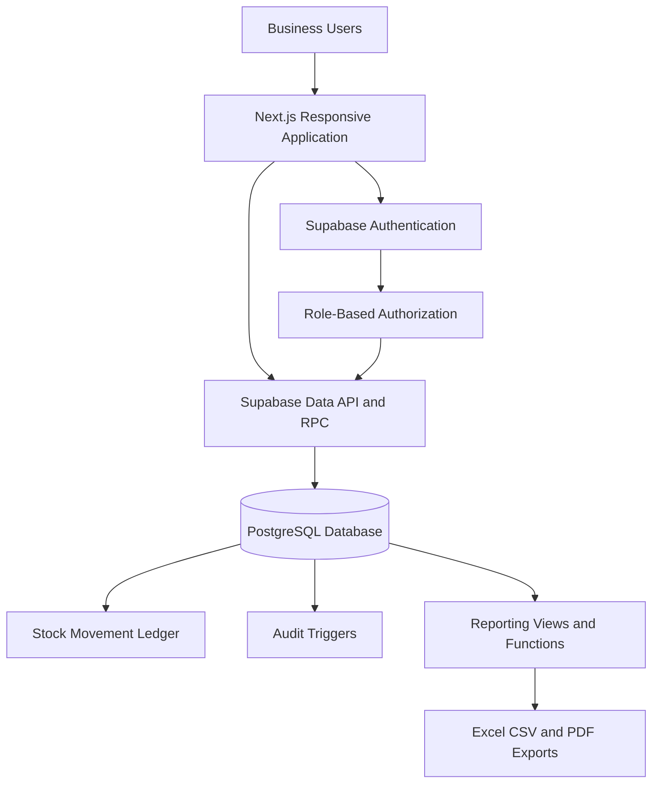
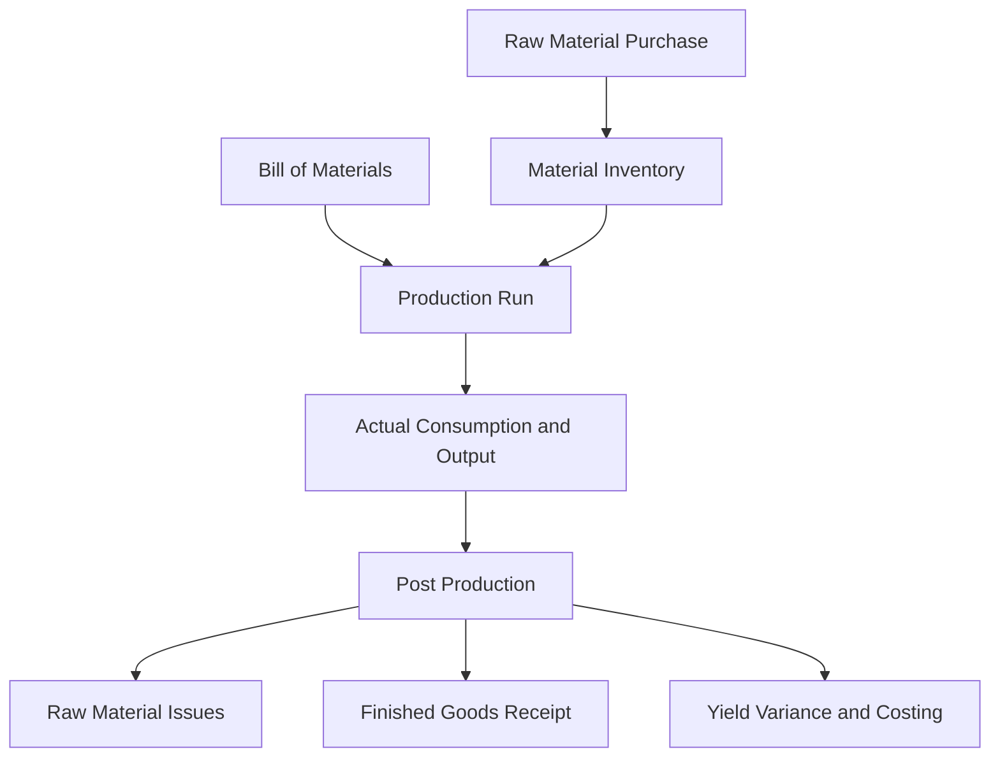

# Order2Audit

### Order-to-Audit System for a Small Food Manufacturer

A role-based manufacturing and business management application that connects sales, production, inventory, GST invoicing, customer payments and audit reporting within a single workspace.

Developed for the **NIT Tiruchirappalli Winter Internship 2026** assignment.

**[Live Application](https://order-to-audit-opal.vercel.app/) | [Source Code](https://github.com/sahanasarop7-hash/order-to-audit) |
[Technical Design Note (PDF)](docs/Order2Audit_Design_Note.pdf)**
---

## 1. Problem Statement

Small food manufacturers often maintain separate records for sales orders, raw-material purchases, production, inventory, invoices and customer payments. This makes stock reconciliation, production costing and monthly audit preparation difficult.

Order2Audit integrates these operations using a shared relational database, ensuring that business transactions contribute to traceable inventory movements and financial reports.

The application focuses on accurate production accounting, stock reconciliation, role-based access and the complete order-to-audit workflow.

## 2. Features

| Module | Implemented functionality |
|---|---|
| Master Data | Products, customers, suppliers, materials and versioned bills of materials |
| Sales | Mobile-friendly order entry, order tracking, stock validation and approval |
| Invoicing | GST calculation, financial-year invoice numbering, PDF generation and credit notes |
| Dispatch | Stock reservation and automatic finished-goods deduction |
| Purchases | Supplier purchases, material receipts and weighted average costing |
| Production | BOM-based planning, actual consumption, yield, wastage and batch costing |
| Inventory | Raw materials, packaging, finished goods, stock ledger and adjustments |
| Payments | Partial payments, outstanding balances, payment reversals and ageing |
| Reports | Sales, purchases, GST, inventory, production and receivables reports |
| Dashboard | Business KPIs, production performance and inventory alerts |
| Audit | Database-generated change history with user, timestamp and correction details |
| Localization | English, Tamil and Hindi interface support |
| Mozhi | Multilingual, read-only voice and text assistant |

### Additional Features

- Material and production yield variance alerts.
- Low-stock and reorder alerts.
- Production profitability and margin analysis.
- Controlled correction and reversal workflows.
- Historical invoice snapshots.
- BOM versioning and protection of previously used recipes.
- Responsive desktop and mobile layouts.

## 3. Technology Stack

| Layer | Technology |
|---|---|
| Frontend | Next.js, React, TypeScript |
| Styling | Tailwind CSS, shadcn/ui, Lucide Icons |
| Database | PostgreSQL through Supabase |
| Authentication | Supabase Auth |
| Authorization | PostgreSQL Row Level Security and role-validated database functions |
| Charts | Recharts |
| PDF Generation | jsPDF, jsPDF-AutoTable |
| Excel Export | ExcelJS |
| Voice Assistant | Web Speech API |
| Deployment | Vercel |
| Version Control | Git and GitHub |

## 4. System Architecture



The frontend handles user interaction, input validation and presentation. Critical business operations are implemented in PostgreSQL functions to keep transaction validation, stock updates and financial calculations consistent.

## 5. User Roles

| Role | Responsibilities |
|---|---|
| Administrator | Master data, order approval, invoicing, dispatch, inventory corrections and administration |
| Salesman | Create orders, edit permitted pending orders and view own sales records |
| Production Supervisor | BOM management, production entry, consumption tracking and inventory monitoring |
| Accountant | Purchases, payments, receivables, GST reports and audit review |
| Owner | Business dashboards, operational visibility and financial reporting |

Access restrictions are enforced at both the application and database levels.

## 6. Business Workflows

### Sales Workflow


Pending orders do not reserve stock. Approval validates available stock and reserves the required quantity. Dispatch reduces physical finished-goods stock.

Insufficient-stock orders remain pending until sufficient inventory becomes available or the order is otherwise resolved.

### Production Workflow



Production posting records material consumption and finished-goods output within a database transaction. Actual consumption is compared with the scaled BOM quantities.

## 7. Database Design and Integrity

The relational database contains separate entities for master data, sales, purchases, production, invoices, payments, stock movements and audit history.

Key design principles:

- Primary and foreign keys maintain relationships between transactions.
- Numeric database types are used for quantities and monetary values.
- Stock balances are derived from the stock movement ledger.
- Critical posting operations execute transactionally.
- Historical invoices retain customer, product, tax and company information.
- Previously used BOM definitions are protected against destructive modification.
- Audit triggers capture business-record changes.
- Row Level Security restricts unauthorized data access.
- Posted transactions use controlled cancellation or reversal workflows rather than unrestricted deletion.

## 8. Inventory and Costing Method

### Stock Reconciliation

Closing Stock = Opening Stock + Receipts − Issues ± Adjustments

Available Stock = Physical Stock − Reserved Stock

Raw materials, packaging materials and finished goods are tracked separately.

Material quantities are maintained in base units such as kilograms, litres and pieces. Supported unit conversions include grams to kilograms, millilitres to litres and cartons to packets.

### Weighted Average Costing

Material valuation uses the moving weighted average method.

New Average Cost = (Existing Stock Value + Purchase Value) / (Existing Quantity + Purchased Quantity)

This method is suitable for materials that are purchased repeatedly at different prices and consumed from a common inventory.

The material unit cost is captured when production is posted, preserving historical production costs.

### Production Cost

Total Production Cost = Actual Material Cost + Labour Cost + Utility Cost

Cost per Packet = Total Production Cost / Actual Good Output

Labour and utility expenses are allocated directly to the production batch and distributed across its actual good output.

### Variance Calculation

Material Variance (%) = ((Actual Consumption − Planned Consumption) / Planned Consumption) × 100

Yield (%) = (Actual Good Output / Planned Output) × 100

Absolute variances greater than 3% are flagged for review.

## 9. Mandatory Benchmark Scenario

### Master Data

Product: Murukku 200 g

Expected batch output: 200 packets

Selling price: ₹50 per packet, excluding GST

GST rate: 5%

Factory location: Tamil Nadu

| Material | BOM Quantity | Opening Stock | Opening Unit Cost |
|---|---:|---:|---:|
| Flour | 40 kg | 100 kg | ₹42 |
| Cooking oil | 10 L | 30 L | ₹140 |
| Salt and spice mix | 1.2 kg | 5 kg | ₹200 |
| Pouches | 200 pieces | 500 pieces | ₹2.50 |
| Cartons | 10 pieces | 30 pieces | ₹15 |

Opening finished goods: 50 packets.

### Benchmark Transactions

1. Purchase 60 kg of flour at ₹45/kg.
2. Produce one batch using 40 kg flour, 10.5 L oil and 1.2 kg spice mix.
3. Record 188 good packets, six damaged pouches and nine cartons consumed.
4. Salesman A places an order for 150 packets for Retailer A in Tamil Nadu.
5. Administrator approves the order, generates the GST invoice and dispatches the goods.
6. Salesman B places an order for 120 packets for Distributor B in Karnataka.
7. The system prevents approval because available stock is insufficient.
8. Record a payment of ₹4,000 from Retailer A.
9. Include ₹1,200 labour and ₹600 gas/power expenses in production costing.
10. Generate monthly operational and financial reports.

### Verified Benchmark Results

| Metric | Expected | Observed |
|---|---:|---:|
| Flour closing stock | 120 kg | 120 kg |
| Oil closing stock | 19.5 L | 19.5 L |
| Spice mix closing stock | 3.8 kg | 3.8 kg |
| Pouches closing stock | 306 | 306 |
| Cartons closing stock | 21 | 21 |
| Finished goods after production | 238 | 238 |
| Finished goods after dispatch | 88 | 88 |
| Production yield | 94% | 94% |
| Yield variance | −6% | −6%, flagged |
| Oil consumption variance | +5% | +5%, flagged |
| Taxable invoice amount | ₹7,500 | ₹7,500 |
| CGST | ₹187.50 | ₹187.50 |
| SGST | ₹187.50 | ₹187.50 |
| Invoice total | ₹7,875 | ₹7,875 |
| Payment received | ₹4,000 | ₹4,000 |
| Outstanding amount | ₹3,875 | ₹3,875 |
| Distributor B shortage | 32 packets | 32 packets |
| Stock ledger entries | 14 | 14 |

The Karnataka order remains pending. IGST applies if the interstate order is subsequently approved and invoiced.

### Benchmark Cost Calculation

Weighted average flour cost:

(100 × 42 + 60 × 45) / 160 = ₹43.125/kg

| Cost Component | Calculation | Amount |
|---|---|---:|
| Flour | 40 × 43.125 | ₹1,725 |
| Cooking oil | 10.5 × 140 | ₹1,470 |
| Spice mix | 1.2 × 200 | ₹240 |
| Pouches | 194 × 2.50 | ₹485 |
| Cartons | 9 × 15 | ₹135 |
| **Total material cost** | | **₹4,055** |
| Labour | | ₹1,200 |
| Gas and power | | ₹600 |
| **Total production cost** | | **₹5,855** |

| Profitability Metric | Result |
|---|---:|
| Actual good output | 188 packets |
| Cost per packet | ₹31.14 |
| Selling price excluding GST | ₹50.00 |
| Estimated production margin per packet | ₹18.86 |
| Estimated production margin percentage | 37.71% |

Damaged pouch costs are included in material consumption. Production margin excludes distribution, administrative and other indirect expenses not included in the benchmark.

## 10. Reporting

The reporting workspace provides 16 reports covering:

- Sales register, customer-wise sales and product-wise sales.
- GST transaction register and outward supply summary.
- Purchase register and supplier-wise purchases.
- Stock summary and stock movement ledger.
- Production summary, consumption variance and production margin.
- Payment collections, invoice receivables, customer outstanding and receivables ageing.

Reports support Excel, CSV and PDF exports. Date filters are provided for period-based reports, while current-balance reports reflect current receivables.

GST reports are intended for accountant review and reconciliation rather than direct statutory filing.

## 11. Mozhi — Multilingual Business Assistant

Mozhi is a lightweight, read-only assistant designed to make business information accessible to users who may prefer regional languages.

Supported languages:

- English
- Tamil
- Hindi

Users can interact using text or browser-supported speech recognition.

Example queries:

- Show available stock.
- How many orders are pending?
- What is the outstanding amount?
- Show production performance.
- Show reorder alerts.

Mozhi uses predefined intent recognition and role-authorized database queries. It does not require a paid large language model API and cannot create or modify business transactions.

Voice functionality depends on browser and language support.

## 12. Project Structure

```text
order-to-audit/
├── app/                 # Next.js pages and layouts
├── components/          # Reusable UI and business components
├── contexts/            # Authentication and language state
├── lib/                 # Business logic and Supabase integration
├── locales/             # English, Tamil and Hindi translations
├── types/               # TypeScript definitions
├── scripts/             # Development utilities
├── supabase/
│   ├── migrations/      # Complete database schema
│   └── benchmark_seed.sql
├── .env.example
├── package.json
└── README.md
```

## 13. Running Locally

### Prerequisites

- Node.js and npm
- Git
- Docker Desktop
- Supabase CLI

The application was developed and tested using Node.js 24 and Next.js 16.

### Step 1: Clone the Repository

```bash
git clone https://github.com/sahanasarop7-hash/order-to-audit.git
cd order-to-audit
npm ci
```

### Step 2: Start Local Supabase

Ensure Docker Desktop is running.

```bash
supabase start
```

The database migration initializes the application schema on a fresh local Supabase instance.

Retrieve the local connection details:

```bash
supabase status
```

### Step 3: Create Demo Authentication Accounts

Open local Supabase Studio at:

http://127.0.0.1:54323

Navigate to Authentication → Users and create the following six accounts with auto-confirmation enabled.

| Email | Role |
|---|---|
| admin@example.com | Administrator |
| salesman.a@example.com | Salesman A |
| salesman.b@example.com | Salesman B |
| production@example.com | Production Supervisor |
| accountant@example.com | Accountant |
| owner@example.com | Owner |

Choose local demo passwords when creating the accounts.

The benchmark seed associates these accounts with application profiles using their email addresses, allowing the seed to work with independently generated authentication IDs.

### Step 4: Load Benchmark Data

```bash
docker exec -i supabase_db_order-to-audit \
  psql -U postgres -d postgres \
  -v ON_ERROR_STOP=1 \
  < supabase/benchmark_seed.sql
```

The seed is intended for a fresh demo database. It verifies that all six authentication accounts exist and rejects repeated imports when benchmark products or stock movements are already present.

It does not truncate existing business records.

### Step 5: Configure Environment Variables

```bash
cp .env.example .env.local
```

Update `.env.local`:

```env
NEXT_PUBLIC_SUPABASE_URL=http://127.0.0.1:54321
NEXT_PUBLIC_SUPABASE_PUBLISHABLE_KEY=your-local-publishable-key
```

Use the publishable key returned by `supabase status`.

For hosted Supabase, use the corresponding hosted project URL and publishable key instead.

Never expose secret keys or service-role credentials in frontend environment variables.

### Step 6: Run the Application

```bash
npm run dev
```

Open:

http://localhost:3000

### Production Build

```bash
npx tsc --noEmit
npm run build
npm run start
```

## 14. Live Demo Access

The hosted application is available at:

https://order-to-audit-opal.vercel.app/

Evaluator login credentials are provided separately with the internship submission.

The hosted demo contains the completed benchmark scenario. Select November 2026 when reviewing date-filtered benchmark reports.

## 15. Testing and Validation

The following checks were performed during development:

| Test | Result |
|---|---|
| Mandatory benchmark calculations | Passed |
| Insufficient-stock approval prevention | Passed |
| Salesman-specific order visibility | Passed |
| Role-based module restrictions | Passed |
| Responsive mobile order entry | Passed |
| GST invoice PDF generation | Passed |
| Report Excel and PDF generation | Passed |
| TypeScript compilation | Passed |
| Next.js production build | Passed |
| Fresh local database migration | Passed |
| Local benchmark restoration | Passed |
| Duplicate seed prevention | Passed |
| Local application authentication | Passed |
| Hosted production verification | Passed |

Validation was performed through SQL queries, manual workflow testing and application-level checks. This is not a comprehensive automated regression or security testing suite.

## 16. Assumptions and Limitations

- The system represents a single manufacturing company based in Tamil Nadu.
- Inventory valuation uses moving weighted average costing rather than FIFO.
- Production labour and utility expenses are allocated directly to each batch.
- The benchmark uses the assignment's assumed GST rate of 5%.
- Demo company GSTIN and other statutory details must be configured before real-world tax invoicing.
- Posted purchase and production reversals are restricted to supported correction scenarios.
- Credit notes support full cancellation of eligible unpaid, undispatched invoices. Dispatched returns, partial credit notes and refunds require additional workflows.
- The application requires an internet connection or access to its local Supabase instance. Offline order synchronization is not implemented.
- Batch-level expiry tracking and FEFO allocation are not implemented.
- Dedicated production scheduling, GPS capture, Tally integration, e-invoicing and e-way bill integrations are outside the implemented scope.
- Tamil and Hindi localization covers major application workflows, but some dynamic messages and report content remain in English.
- Invoice PDFs use English formatting; multilingual PDF font support remains a future enhancement.
- The benchmark seed restores business data rather than reconstructing the original historical audit events.

## 17. Future Enhancements

- Offline-first sales order entry and synchronization.
- Batch-level inventory traceability and expiry management.
- Production planning and material requirement forecasting.
- Sales returns and refund workflows.
- Accounting software integration.
- Statutory GST integrations.
- Expanded automated integration and concurrency testing.
- Complete multilingual reporting and PDF support.

## 18. Author

**Sahana Saro P**

Computer Science and Engineering  
Sathyabama Institute of Science and Technology

Developed as part of the NIT Tiruchirappalli Winter Internship 2026 application assignment.